# Employee & Workforce Analytics
## Comprehensive Statistical and Analytical Report | 2021–2025

**Study type:** Longitudinal descriptive and explanatory analysis of a **synthetic** workforce  
**Audience:** Analysts, HR analytics practitioners, reviewers, and technical stakeholders  
**Source workflow:** PostgreSQL relational analytical view → Python/Pandas quality checks → exploratory analysis → statistical and predictive models  
**Period:** 60 monthly periods, January 2021–December 2025  
**Primary reproducible analysis:** `01_workforce_eda_cleaned_v2.ipynb`, Steps 13–65

> **Disclosure.** The employer, employees, pay arrangements, review and separation processes are generated by a simulation. The findings describe patterns *inside this synthetic dataset*. Many relationships reflect assumptions embedded in the generator, not independent evidence about real employers. Associations, model coefficients, and intervals must not be read as causal effects.

---

## 1. Research objectives and analytical questions

This report evaluates **what the workforce data contain, how reliably different sources agree, which measurable patterns coincide with turnover and compensation outcomes, and how much information remains after statistical adjustment**. Its main questions are:

1. How did headcount, turnover, and separation type change between 2021 and 2025?
2. Do rates vary across organizational tenure, job levels, departments, compensation position, performance status, and time in role?
3. Which differences are descriptively substantial, which persist in cluster-aware uncertainty analysis, and which remain after multivariable adjustment?
4. How are annual salary adjustments distributed, and what explains changes in cross-sectional average salaries?
5. How successfully do simple regression and classification models describe or predict the simulated outcomes?
6. Which data discrepancies and modeling limitations must accompany any downstream business interpretation?

The report deliberately separates **descriptive rates**, **statistical evidence**, **model performance**, and **business implications**. The companion [Executive Business Report](Employee_Workforce_Executive_Report.md) translates selected results into decision options without statistical jargon.

## 2. Data architecture, SQL, analytical grain, and reproducibility

### 2.1 PostgreSQL as the analytical data source

The Python notebook connects to the PostgreSQL database `workforce_analytics` via `psycopg` and reads:

```sql
SELECT *
FROM analytics.vw_employee_monthly;
```

This is the **actual SQL query visible in Step 13** of the reviewed notebook, not a reconstructed claim about earlier SQL work. The view returns **290,014 rows and 21 source columns**, subsequently transformed into typed analytical columns. Separation type analysis also reads the separately supplied `separation_history_clean.csv`, then explicitly matches its employee IDs against the validated termination cohort.

PostgreSQL's role in the project is **data structuring and access**; Python's role in this phase is **statistical profiling, visualization, modeling, and final reconciliation**. The Phase 1–4 PostgreSQL scripts were not supplied with this report-building request, so the precise upstream cleaning SQL, staging tables, keys, and view-definition logic are **not independently audited here**. Their source scripts should be linked in the repository rather than invented in this report.

### 2.2 Units of analysis

| Analytical unit | Population / size | Appropriate interpretation |
|---|---:|---|
| Full monthly extract | **290,014 employee-month rows** | Longitudinal descriptive coverage; repeated employee observations |
| Unique employee IDs | **8,430** | Distinct employees observed across five years |
| Observation window | **60 months** | Monthly series, January 2021–December 2025 |
| Active-status monthly rows | **286,475** | Active employee-month observations (not 286,475 people) |
| Matched final terminated employees | **3,539** | Validated terminated employee cohort |
| December 2025 active snapshot | **4,867** | Active in the observed December record |
| Latest available active row per person | **8,306 employees** | Cross-sectional analysis of each person's *latest active observation*, including some later terminated workers |
| Next-month separation panel | **281,608 employee-month rows; 8,244 people; 3,415 events** | Exposures that have an observable next-month outcome |
| April eligible salary comparisons | **23,364 employee-year comparisons** | Consecutive March–April salary-pair denominator |
| Corrected salary-change OLS | **20,522 observations; 6,193 people** | Eligible nonmissing regression sample |
| Raise-participation logistic model | **19,473 observations; 5,988 people** | Restricted, rated and eligible comparisons |

**Critical distinction:** The 8,306-person “latest active observation” population is **not** a December 2025 headcount. The 3,415 events in the next-month analysis omit first-observed termination events and other observations without a valid next-month risk window; they should not be equated with all 3,539 separations.

### 2.3 Reproducibility and definitions

The notebook retains all **21 source fields**, including the original redundant promotion-timing field for audit purposes, but excludes that field from final explanatory predictors. It converts dates and numerical columns, checks employee-month duplicates, and preserves observed missingness rather than replacing all absent values by assumption.

**Time conventions:** Monthly snapshots are observed at a monthly grain; annual turnover uses annual separations divided by the mean of monthly active headcounts. This is a descriptive exposure approximation, not a survival-analysis hazard estimate. The first month lacks December 2020 headcount, so its monthly denominator uses the first observed active count.

## 3. Data quality and measurement validity

### 3.1 Structural checks and missingness

The extracted panel has **8,430 unique employees**, **60 calendar months**, and **zero duplicate employee-month keys**. Data integrity checks retain every original observation in the typed analytical dataset. Missing data are concentrated in a small number of fields:

| Field | Missing records | Missing share | Practical consequence |
|---|---:|---:|---|
| Latest performance rating | **39,926** | **13.77%** | Analysis requires explicit missing/eligibility status |
| Unscheduled absence days | **4,361** | **1.50%** | Do not treat NA automatically as zero days |
| Average weekly hours | **2,934** | **1.01%** | Complete-case models can slightly change the sample |
| Manager ID | **60** | **0.02%** | Potential organizational-chart completeness issue |

Performance-rating missingness is **strongly tenure-dependent**, not simply a random reporting defect:

| Organizational tenure | Rating coverage |
|---|---:|
| 0–5 months | **0.00%** |
| 6–11 months | **14.34%** |
| 12–23 months | **78.71%** |
| 24–59 months | **100.00%** |
| 60+ months | **100.00%** |

L1 had only **70.83%** raw rating coverage versus **92.98%** at L3. After standardizing tenure composition, L1's coverage estimate rose to **86.10%** (L3: **86.20%**). Thus, much of the crude level difference was associated with tenure mix. Treating “not yet rated” as performance failure would be analytically indefensible.

### 3.2 Reconciliation discrepancies

Three source-consistency findings warrant explicit documentation:

**A. Final active status versus December monthly snapshot.** The final employee-level source records **4,891 active people**, while the December 2025 monthly active snapshot contains **4,867**. The **24 unmatched final-active employees** have their last monthly observations in August (1), September (7), October (4), or November (12) of 2025. These counts are not interchangeable; the cause has not been proven solely by identifying the mismatch.

**B. Separation history versus validated cohort.** The separation-history CSV contains **3,580 unique employee records** (2,812 voluntary and 768 involuntary at source level). The analytical panel validates **3,539 terminated IDs**; all 3,539 match a separation-history record, while **41 source IDs fall outside the validated termination cohort**. For the matched cohort, separation type is complete: **2,777 voluntary** and **762 involuntary**.

**C. Redundant career measures.** Across **all 290,014 monthly rows**, `role_tenure_months` and `months_since_last_promotion` are **exactly equal**—not merely correlated. The generator initializes, increments, and resets the two counters together. As a result, the latter cannot identify a promotion-delay effect independently of time in current role. It is **retained in raw data for traceability but excluded from final correlation and turnover regression predictors**. No original data were rewritten to force the variables apart.

These issues are notable precisely because the panel can look internally clean on one metric while retaining important **cross-source and construct-validity disagreements**.

## 4. Workforce size and turnover over time

### 4.1 Workforce headcount trajectory

Active monthly headcount began at **4,923 (January 2021)**, reached a minimum of **4,669 (April 2022)**, and ended at **4,867 (December 2025)**. The endpoint change is **−56 employees (−1.14%)**. The 2025 mean monthly active headcount (**4,829.7**) exceeds the 2022 mean (**4,728.9**), consistent with a late-period workforce recovery.

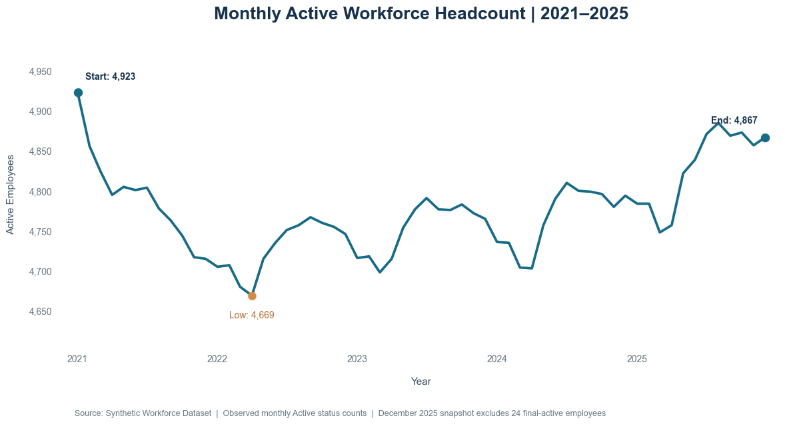

*Figure 1. Observed active headcount. Note the difference from final employee-master active status.*

### 4.2 Annual turnover formula and rates

$$
\text{Annual turnover rate}_y=\frac{\text{Recorded separations in year }y}{\text{Mean monthly active headcount in year }y}\times100.
$$

| Year | Separations | Mean active headcount | Turnover rate |
|---|---:|---:|---:|
| **2021** | 780 | 4,793.83 | **16.27%** |
| **2022** | 725 | 4,728.92 | **15.33%** |
| **2023** | 704 | 4,753.50 | **14.81%** |
| **2024** | 730 | 4,767.00 | **15.31%** |
| **2025** | 600 | 4,829.67 | **12.42%** |

The difference between 2021 and 2025 is **−3.85 percentage points**, not a 3.85% relative reduction. Annual rates are not monotonic: 2024 rose somewhat before the 2025 reduction.

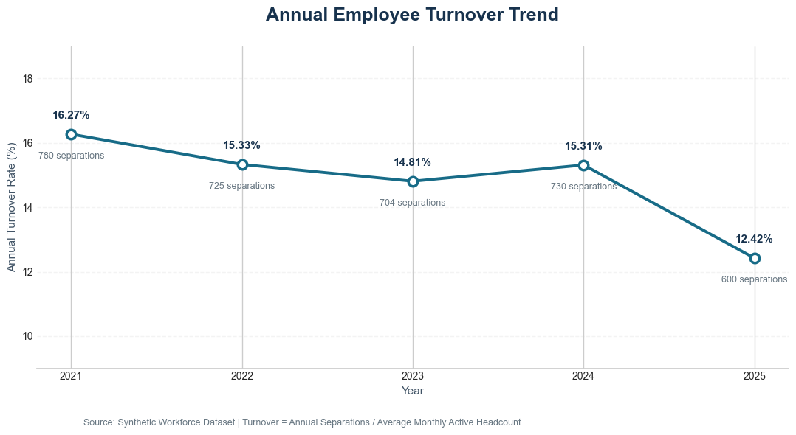

*Figure 2. Annual rate uses average monthly active headcount as the denominator.*

### 4.3 Voluntary versus involuntary separations

| Year | Voluntary exits | Voluntary rate | Involuntary exits | Involuntary rate |
|---|---:|---:|---:|---:|
| 2021 | 607 | 12.66% | 173 | 3.61% |
| 2022 | 572 | 12.10% | 153 | 3.24% |
| 2023 | 554 | 11.66% | 150 | 3.16% |
| 2024 | 581 | 12.19% | 149 | 3.13% |
| 2025 | 463 | 9.59% | 137 | 2.84% |
| **Total** | **2,777** | — | **762** | — |

Voluntary exits represent **78.5% of the validated total**. However, the next-month logistic model later in this report predicts **all-cause** exit, not voluntary and involuntary departures separately. One should not claim its predictors explain voluntary exits in particular.

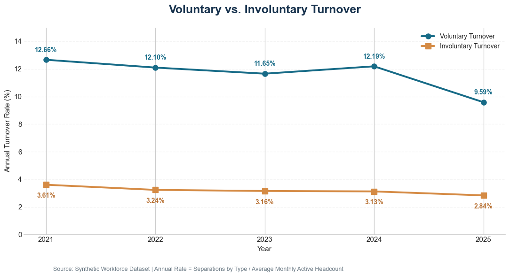

*Figure 3. Separation-type rates are reconciled to the valid panel cohort, not the unfiltered history table.*

## 5. Turnover heterogeneity: levels, tenure, departments

### 5.1 Job levels

Annualized exposure estimates use **separations / active employee-months × 12 × 100**. This denominator differs from the yearly average-headcount method, so figures should not be combined as if interchangeable without acknowledging the definitions.

| Job level | Active employee-months | Separations | Annualized rate |
|---|---:|---:|---:|
| L1 | 69,258 | 1,146 | **19.86%** |
| L2 | 92,339 | 1,173 | **15.24%** |
| L3 | 78,393 | 817 | **12.51%** |
| L4 | 29,782 | 260 | **10.48%** |
| L5 | 11,939 | 101 | **10.15%** |
| L6 | 4,255 | 40 | **11.28%** |
| L7 | 449 | 2 | **5.35%** |
| L8 | 60 | 0 | **0.00%** |

L1 shows a materially elevated observed rate, while L7–L8 have very few departure events and should **not** be characterized as intrinsically safe levels.

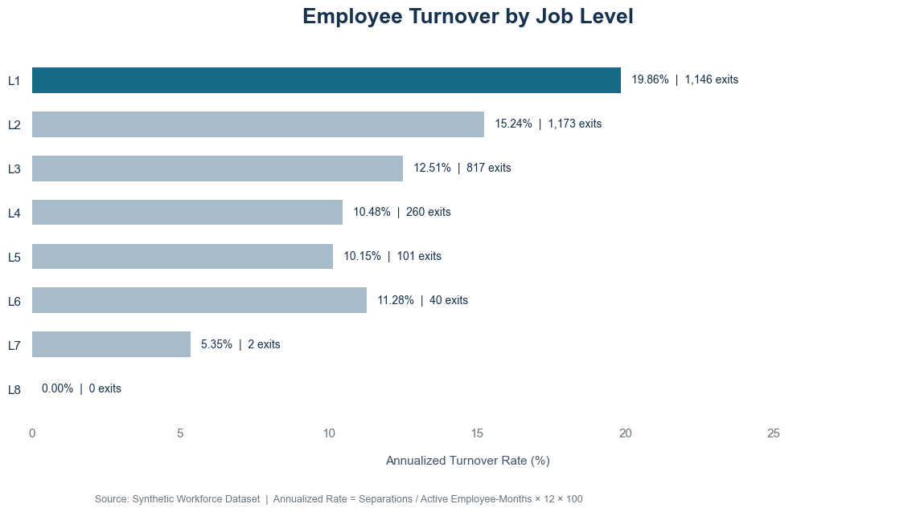

*Figure 4. Job-level exposure and sparse upper-level categories.*

### 5.2 Organizational tenure

| Tenure category | Employee-months | Separations | Annualized rate |
|---|---:|---:|---:|
| 0–1 year | 37,894 | 614 | **19.44%** |
| 1–3 years | 61,699 | 1,062 | **20.66%** |
| 3–5 years | 53,659 | 587 | **13.13%** |
| 5–10 years | 87,358 | 877 | **12.05%** |
| 10+ years | 45,865 | 399 | **10.44%** |

The highest observed rate falls in the **1–3-year** group rather than the first year, suggesting a non-linear relationship. These are segment associations; the model later adjusts for other observed characteristics.

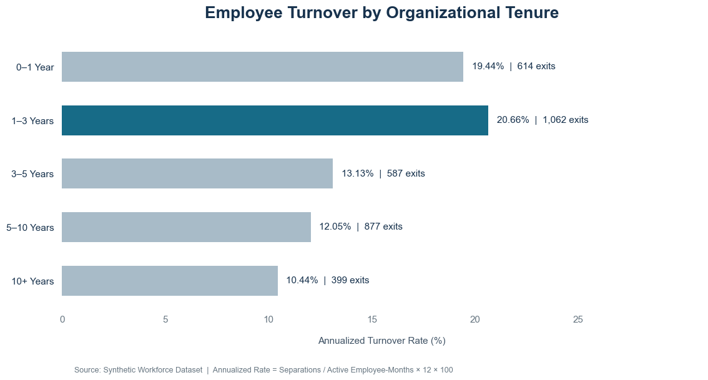

*Figure 5. Non-monotonic early-tenure exposure.*

### 5.3 Departments: rate and event-volume ranking are different

| Department | Employee-months | Separations | Annualized rate |
|---|---:|---:|---:|
| Human Resources | 16,455 | 219 | **15.97%** |
| Corporate Services | 25,780 | 334 | **15.55%** |
| Risk & Compliance | 20,621 | 262 | **15.25%** |
| Operations | 69,009 | **859** | **14.94%** |
| Marketing | 16,730 | 204 | 14.63% |
| Finance | 26,956 | 328 | 14.60% |
| Technology | 57,481 | 698 | 14.57% |
| Client Services | 53,443 | 635 | 14.26% |

The range in rates is relatively narrow compared with the tenure or job-level contrasts. Operations has the highest **number** of exits, whereas Human Resources has the highest **rate**. In the adjusted model, the reported department contrasts were not individually statistically distinguishable from the baseline at the nominal 5% level after accounting for included predictors. A high raw department rate should not automatically be interpreted as a department-specific causal effect.

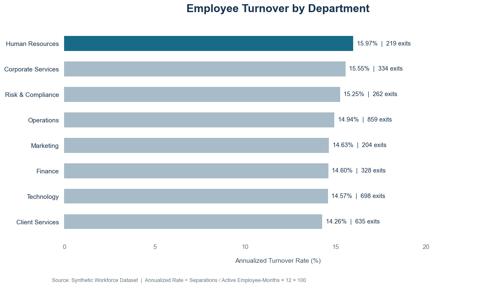

*Figure 6. Department risk must be read together with organization size.*

## 6. Monthly pre-separation factors

A distinct risk panel was constructed to associate characteristics recorded in an active employee-month with **termination in the following month**. It contains **281,608 observations across 8,244 employees** and **3,415 subsequent separation events**, an event frequency of **1.213%**. This time ordering reduces one common ambiguity in cross-sectional analysis, but does not eliminate confounding or prove causation.

### 6.1 Compensation-position segments

| Compa-ratio | Employee-months | Following-month exits | Exit rate |
|---|---:|---:|---:|
| <0.80 | 7,300 | 112 | **1.534%** |
| 0.80–0.89 | 48,563 | 675 | 1.390% |
| 0.90–0.99 | 84,560 | 1,116 | 1.320% |
| 1.00–1.09 | 79,888 | 923 | 1.155% |
| 1.10+ | 61,297 | 589 | **0.961%** |

The rate declines across the presented compensation-position categories. The **absolute difference** between the lowest and highest groups is **0.573 percentage points per employee-month**. It is not correct to describe that as a 0.573% change or to equate it with the estimated effect of granting a raise.

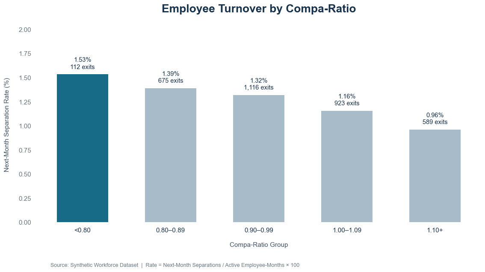

*Figure 7. A descriptive pay-position gradient in next-month exit probability.*

### 6.2 Performance-rating groups

| Rating status | Employee-months | Following-month exits | Exit rate |
|---|---:|---:|---:|
| Low (≤2) | 61,176 | 1,121 | **1.832%** |
| 3 | 120,569 | 1,167 | 0.968% |
| 4 | 50,085 | 373 | 0.745% |
| High (>4) | 11,450 | 78 | **0.681%** |
| Missing | 38,328 | 676 | **1.764%** |

Low versus high ratings differ by **1.151 percentage points** on the next-month outcome. However, involuntary exits are part of the response variable, and rating availability is correlated with employee tenure. Consequently this finding **does not isolate a retention mechanism for high versus low performers**, and “Missing” is not itself a performance category.

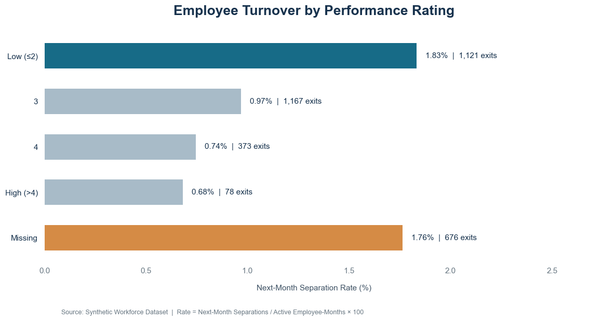

*Figure 8. Rates shown separately for missing performance information.*

### 6.3 Time in current role

| Current-role tenure | Employee-months | Following-month exits | Exit rate |
|---|---:|---:|---:|
| 0–12 months | 63,012 | 785 | 1.246% |
| 13–24 months | 49,147 | 778 | **1.583%** |
| 25–48 months | 65,787 | 711 | **1.081%** |
| 49+ months | 103,662 | 1,141 | 1.101% |

The largest crude rate appears at **13–24 months**. The adjusted 49+ contrast later differs from the simple unadjusted comparison: this is a useful demonstration of why a model adjusted for organization tenure, pay, job level, performance and year can produce a different ordering of group effects than raw rates.

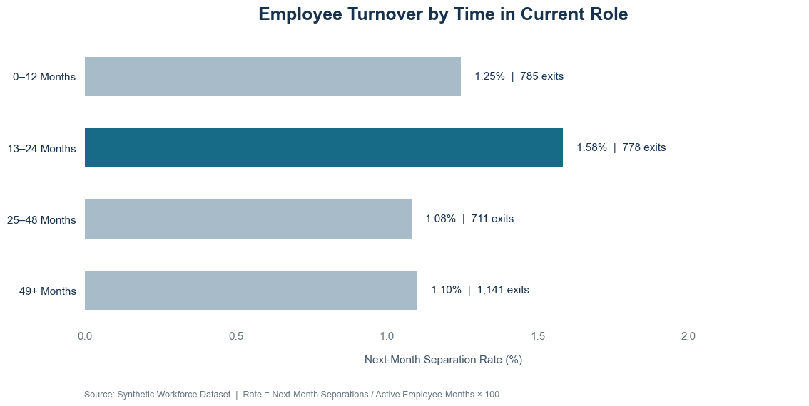

*Figure 9. This is **current-role tenure**, not an independent measurement of promotion delay.*

## 7. Statistical inference, uncertainty, and effect sizes

### 7.1 Exploratory categorical association tests

| Factor | Pearson χ² | Degrees of freedom | Naive p-value | Cramer's V |
|---|---:|---:|---:|---:|
| Compa-ratio | 61.763 | 4 | 1.24 × 10⁻¹² | **0.0148** |
| Performance rating (including missing) | 472.125 | 4 | 7.15 × 10⁻¹⁰¹ | **0.0409** |
| Time in current role | 77.248 | 3 | 1.19 × 10⁻¹⁶ | **0.0166** |

These p-values are **naive** because employee-month observations belonging to the same worker are not independent. Their large-sample significance contrasts with **small Cramer's V values**, reminding us that statistical significance does not imply strong classification power or material business impact.

### 7.2 Employee-cluster bootstrap contrasts

To preserve within-person dependence, the analysis resampled employees rather than individual monthly rows, using **500 bootstrap replications**:

| Contrast | Difference in next-month exit rate | 95% employee-cluster bootstrap CI |
|---|---:|---:|
| Compa-ratio <0.80 vs 1.10+ | **+0.573 pp** | **[+0.295, +0.833] pp** |
| Low performance vs high | **+1.151 pp** | **[+0.955, +1.332] pp** |
| Role tenure 13–24 vs 25–48 months | **+0.502 pp** | **[+0.357, +0.622] pp** |

All three displayed intervals exclude zero **under the chosen bootstrap procedure**. They support a stable descriptive difference within this simulation but do not resolve omitted variables, representativeness, selection effects, or causality. Nominal intervals are not adjusted for multiple exploratory comparisons.

## 8. Multivariable adjusted exit analysis

### 8.1 Model specification

A binomial GLM with a logistic link was fit to **281,608 employee-month observations**, **8,244 unique employees**, and **3,415 following-month events**. Predictors include categorized compa-ratio, performance status, role tenure, organizational tenure, job level, department, and calendar year. Standard errors are **cluster-robust by employee** to account for repeated monthly observations.

**Reference groups:** compa-ratio **1.10+**; performance **high (>4)**; role tenure **25–48 months**; organizational tenure **10+ years**; job level **L3**; department baseline determined by model encoding; year **2021**. The current-role field replaces the redundant promotion-timing field.

### 8.2 Selected adjusted estimates

| Predictor contrast | Adjusted odds ratio | 95% cluster-robust CI | Interpretation |
|---|---:|---:|---|
| Low vs high performance | **2.315** | [1.834, 2.923] | Higher adjusted odds; all-cause separations |
| Missing vs high performance | **2.011** | [1.510, 2.678] | Missingness/eligibility marker, not low performance |
| Organizational tenure 0–1 vs 10+ years | **2.206** | [1.642, 2.962] | Large early-tenure difference |
| Organizational tenure 1–3 vs 10+ years | **1.933** | [1.621, 2.305] | Elevated early-to-mid-tenure difference |
| Compa-ratio <0.80 vs 1.10+ | **1.542** | [1.240, 1.917] | Relative pay position retains association |
| Role tenure 49+ vs 25–48 months | **1.456** | [1.291, 1.642] | Adjusted role-tenure contrast |
| Role tenure 13–24 vs 25–48 months | **1.228** | [1.100, 1.372] | Adjusted role-tenure contrast |
| Role tenure 0–12 vs 25–48 months | **0.743** | [0.621, 0.890] | Lower adjusted odds |
| L1 vs L3 | **1.137** | [1.027, 1.258] | Smaller remaining level contrast |
| 2025 vs 2021 | **0.808** | [0.721, 0.905] | Calendar-time difference conditional on covariates |

**An odds ratio is not a risk ratio.** For example, an OR of 2.315 should not be narrated as “a 131.5% higher probability of departure.” The underlying next-month event prevalence is low, but the interpretation still remains one of *odds*.

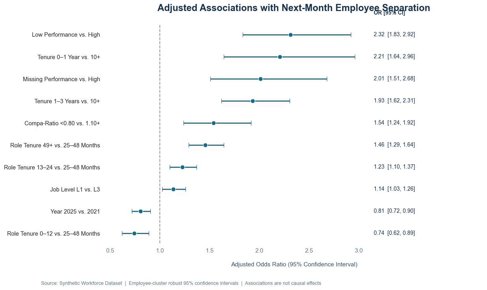

*Figure 10. Selected adjusted estimates. The vertical reference at OR = 1 represents no difference in odds.*

### 8.3 Confounding and model fit

The department-specific contrasts shown in Step 64 do not reach nominal 5% statistical significance after adjustment; this does not imply identical department outcomes. The **2025 year coefficient** remains below 1 relative to 2021 in this specification. Neither contrast identifies what managerial action caused a difference.

| Diagnostic | Value |
|---|---:|
| Converged | Yes |
| Number of model parameters | 32 |
| In-sample ROC-AUC | **0.6318** |
| In-sample Brier score | **0.011948** |
| Constant-prevalence baseline Brier | **0.011980** |
| Relative Brier improvement | **0.27%** |

The fitted model ranks outcomes **better than random** in sample, but only modestly. A **0.27%** relative reduction in Brier score from the constant-rate baseline is extremely small in practical terms. These are **in-sample diagnostics**, with **no temporal out-of-sample validation of the turnover model** in this report. Its principal value is adjusted descriptive interpretation, not dependable individual prediction.

## 9. Compensation distributions and longitudinal salary behavior

### 9.1 Salary distribution by job level

A comparison of all employee-month rows would overweight employees with longer data histories. The primary figure therefore uses the **latest available active observation per employee (8,306 people)** and presents distributions within levels.

| Level | Employee count | Median annual base salary |
|---|---:|---:|
| L1 | 2,224 | **$59,050** |
| L2 | 2,670 | **$76,990** |
| L3 | 2,190 | **$102,255** |
| L4 | 785 | **$132,580** |
| L5 | 315 | **$167,990** |
| L6 | 111 | **$232,760** |
| L7 | 10 | **$368,095** |
| L8 | 1 | **$847,040** |

Job level structures salary comparisons, but its upper categories are sparse. The extremes are consistent with simulated pay-band multipliers and should not be presented as a market compensation benchmark.

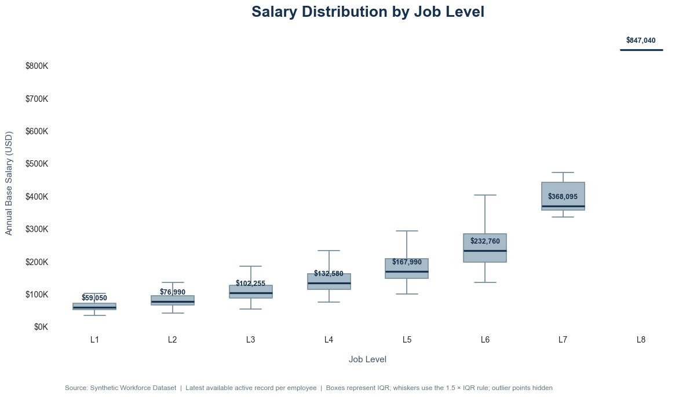

*Figure 11. Boxplots omit point-level outlier markers for legibility, not underlying observations.*

### 9.2 Cross-sectional monthly salary trends

January 2021 mean and median active base salaries were **$91,998** and **$81,370**. By December 2025 they were **$99,861** and **$88,600**, changes of **+8.55%** and **+8.89%** respectively. These numbers compare **changing workforce populations**, not raises earned by continuously employed individuals.

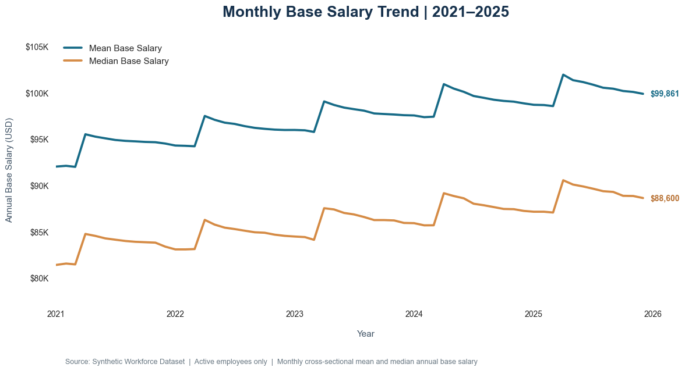

*Figure 12. The workforce mean combines within-employee pay movements with employment entry and exit.*

### 9.3 Workforce-composition decomposition

An exact arithmetic decomposition splits change in monthly average salary into:

$$
\Delta\bar S_t=\text{within-employee pay effect}+\text{entrant composition effect}+\text{exit composition effect}.
$$

The largest absolute reconciliation error across the verified monthly decomposition was approximately **1.29 × 10⁻¹¹ dollars**, a negligible floating-point residual. For **April 2025**, the observed mean salary change was **+$3,395.27**, decomposed into **+$3,548.24** from continuing employees, **−$226.66** from entrants, and **+$73.69** from exits. For **May 2025**, the mean fell **$594.95** even though the within-employee effect was zero; new entrants were a major downward composition component (**−$755.27**), partly offset by exits (**+$160.31**).

Thus, interpreting every dip or rise in monthly average pay as an individual pay adjustment would be a compositional error.

### 9.4 Compa-ratio and position within salary bands

The compa-ratio is **actual base salary divided by pay-band midpoint**, not a salary-growth percentage. Median values by level in the latest-active sample were **0.978 (L1)**, **0.989 (L2)**, **1.019 (L3)**, **1.027 (L4)**, **1.027 (L5)**, **1.059 (L6)**, and **1.145 (L7)**. L8 is excluded from the boxplot because its sample is a single employee.

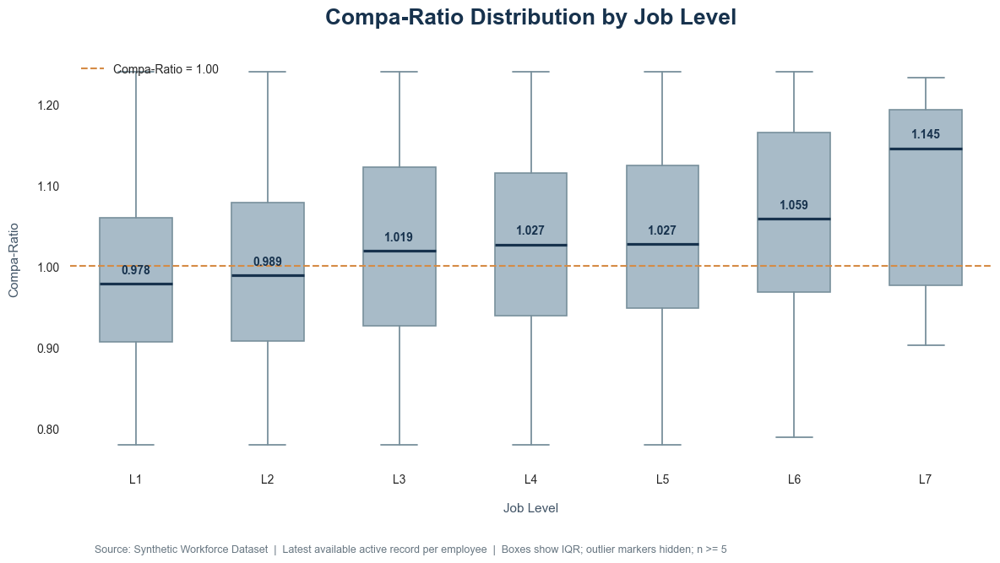

*Figure 13. Reference line at compa-ratio = 1.00; variability is affected by modeled salary-band constraints.*

### 9.5 Consecutive-employee salary changes

There are **278,169 valid consecutive employee-month salary pairs**, with **18,731 positive changes** involving **6,025 distinct employees**. Among positive changes:

| Distribution metric | Result |
|---|---:|
| Median increase | **3.770%** |
| Mean increase | **4.823%** |
| 90th percentile | **9.485%** |
| 95th percentile | **13.625%** |
| 99th percentile | **20.020%** |
| Maximum | **35.405%** |

The positive-change distribution is right-skewed. The histogram displays observations up to the 99th percentile to preserve readability; summary metrics use **all** positive changes.

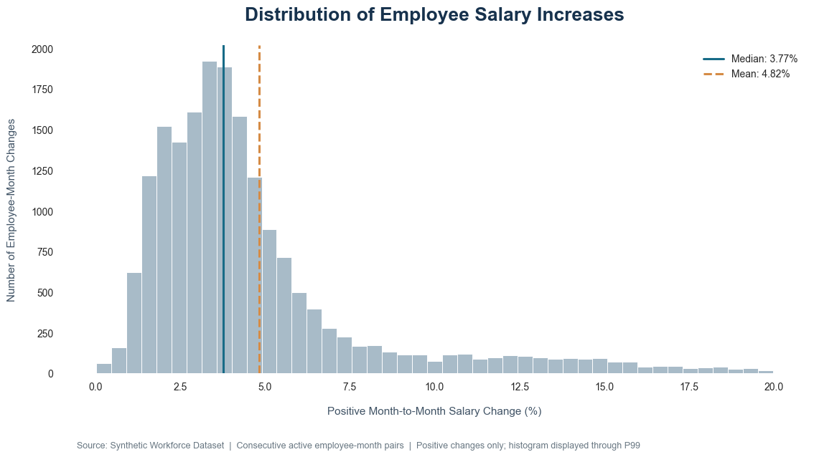

*Figure 14. The number of increases is an event count across months, not a unique-person count.*

### 9.6 Timing of salary changes is generated, not discovered

All **18,731** observed positive consecutive-month salary changes occurred in **April**. Of the **23,364 eligible April comparisons**, **80.17%** showed an increase. The generator explicitly defines an April merit cycle and processes promotions in that month. Consequently, this pattern **cannot be used to infer an emergent seasonal payroll phenomenon**. It is documented as a data-generating constraint and is deliberately not given a separate executive chart.

## 10. Salary adjustment participation and amount models

### 10.1 Prior performance and salary adjustments

Among April comparisons, prior-rating groups demonstrate steep differences in the **mean percentage salary change across all eligible pairs**:

| Prior rating | Employee-year pairs | Received increase | Raise participation | Mean change across all pairs |
|---|---:|---:|---:|---:|
| 1 | 1,082 | 0 | **0.00%** | **0.00%** |
| 2 | 4,392 | 3,221 | **73.34%** | **1.33%** |
| 3 | 10,502 | 10,300 | **98.08%** | **4.42%** |
| 4 | 4,332 | 4,252 | **98.15%** | **6.71%** |
| 5 | 988 | 958 | **96.96%** | **9.19%** |
| Missing prior rating | 2,068 | 0 | **0.00%** | **0.00%** |

The “Missing” row includes records without a prior rating; it should not be interpreted as a punitive pay decision without considering rating eligibility. The generator's merit matrix directly uses prior performance and compa-ratio, so much of this association is **built into the synthetic process**.

### 10.2 Corrected salary-change OLS (Step 44)

The corrected model fits **20,522 observations from 6,193 people**, with employee-cluster robust standard errors, a **15-column full-rank design matrix**, and a **condition number of 15.15**. It achieves **R² = 0.364** and adjusted R² = **0.363**.

Selected coefficients, interpreted in **percentage points of salary change**, holding the other included categories constant:

| Contrast | OLS coefficient | 95% CI |
|---|---:|---:|
| Prior rating 2 vs 1 | **+1.341 pp** | [1.269, 1.413] |
| Prior rating 3 vs 1 | **+4.341 pp** | [4.247, 4.435] |
| Prior rating 4 vs 1 | **+6.587 pp** | [6.436, 6.737] |
| Prior rating 5 vs 1 | **+9.023 pp** | [8.669, 9.376] |
| Level L3 vs L1 | **+1.637 pp** | [1.497, 1.777] |
| Organizational tenure 60+ vs 12–23 months | **−1.953 pp** | [−2.131, −1.775] |

The original exploratory Step 43 specification produced a rank-deficient design with invalid standard errors; **Step 44 is the corrected model used for interpretation**. The corrected residual distribution remains markedly skewed (**skew ≈ 2.73; excess tails reflected in kurtosis ≈ 14.98**). Cluster-robust errors address within-employee correlation in uncertainty estimates, but do not eliminate specification or distributional limitations.

### 10.3 Recipient-only model and compensation position

A recipient-only OLS used **18,043 positive-adjustment events** from **5,802 employees**. R² was **0.293** before adding pre-adjustment compa-ratio and **0.341** afterward (**+0.0486**). Mean raise among recipients declined across higher pre-adjustment relative-pay groups:

| Pre-adjustment compa-ratio | Recipient events | Mean increase |
|---|---:|---:|
| Below 0.90 | 3,701 | **6.396%** |
| 0.90–1.00 | 5,670 | **5.073%** |
| 1.00–1.10 | 5,262 | **4.517%** |
| Above 1.10 | 3,410 | **3.319%** |

In the extended regression, a **0.10 increase in compa-ratio** is associated with approximately **0.852 percentage points less raise amount**, conditional on the modeled covariates (**95% CI roughly −0.905 to −0.800**). This gradient reflects compensation design assumptions in the simulator. A quadratic term increases R² from **0.3412 to 0.3418**: detectable curvature, limited incremental explanatory gain.

### 10.4 Raise participation: logistic model and temporal validation

The eligible raise-participation model contains **19,473 observations**, of which **18,043 received an increase** and **1,430 did not**. Training and in-sample assessment showed **pseudo R² = 0.2817**, **ROC-AUC = 0.8978**, and **Brier = 0.0585**. These metrics must be viewed alongside the extreme positive-class prevalence (**92.66%**).

A more useful diagnostic holds out **2025** after training on **2021–2024**:

| Holdout measure | 2025 result |
|---|---:|
| Training observations | **15,566** |
| Test observations | **3,907** |
| Raise prevalence in holdout | **91.43%** |
| ROC-AUC | **0.8889** |
| PR-AUC | **0.9894** |
| Brier score | **0.0694** |
| No-raise recall, threshold 0.50 | **7.46%** |
| No-raise recall, threshold 0.90 | **66.57%** |

The high PR-AUC is partly a consequence of the high rate of the positive “raise received” class. Changing the classification threshold improves detection of **no-raise** outcomes while substantially increasing false alerts. These results do **not** support claiming reliable identification of every no-raise case. The holdout is for **raise participation only**; it should not be mistaken for out-of-sample validation of the turnover model.

## 11. Correlations and relationships among numerical attributes

To avoid repeatedly weighting the same employee, the correlation matrix uses **8,306 latest available active observations**, **seven nonredundant numeric variables**, and **pairwise-complete Pearson correlations**.

| Relationship | Pearson r | Interpretation |
|---|---:|---|
| Organizational tenure ↔ current-role tenure | **0.815** | Strong positive relation; overlapping career duration |
| Compa-ratio ↔ current-role tenure | **0.550** | Moderate positive relation |
| Base salary ↔ organizational tenure | **0.481** | Moderate positive relation |
| Compa-ratio ↔ organizational tenure | **0.445** | Moderate positive relation |
| Base salary ↔ compa-ratio | **0.355** | Moderate positive relation |
| Base salary ↔ performance rating | **0.096** | Weak positive linear association |
| Base salary ↔ unscheduled absence | **0.003** | Essentially no observed *linear* association |

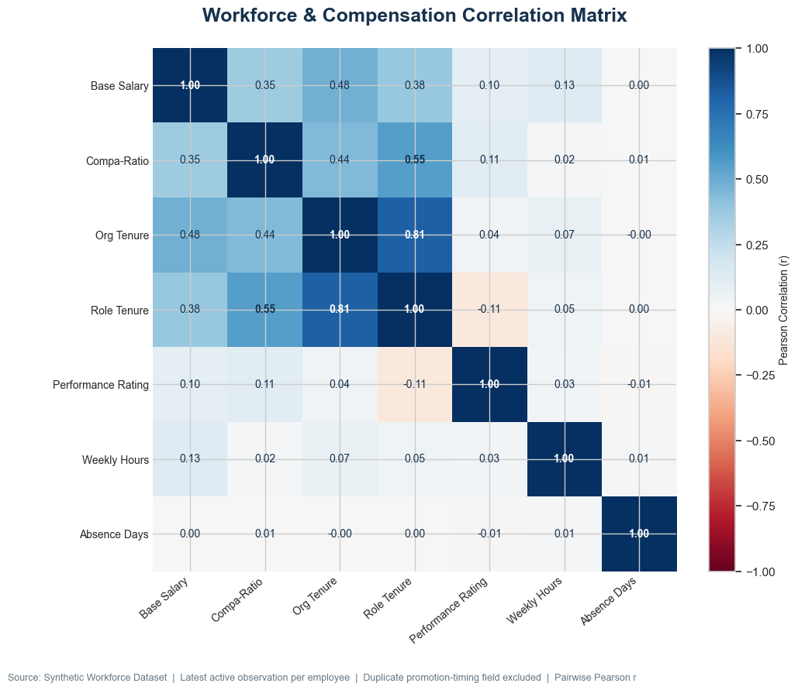

*Figure 15. Redundant `months_since_last_promotion` has been excluded; correlations describe linear associations only.*

Pearson r may hide nonlinear and subgroup-specific relationships, and pairwise deletion produces somewhat different denominators. For example, complete salary/tenure pairs use **8,306 employees**, while salary/performance uses **6,713** due to missing ratings. A weak correlation cannot establish absence of any connection.

## 12. Cross-analysis interpretation: what is robust and what remains uncertain

### 12.1 Repeated signals

**Early organizational tenure.** Higher annualized turnover among first-three-year employees is visible descriptively and persists after adjustment, particularly in 0–1 and 1–3-year categories versus 10+ years. However, the risk is not constant within this range; unmeasured hiring mix and time effects could contribute.

**Low relative pay position.** A monotonic crude compa-ratio gradient, positive cluster-bootstrap contrast, and adjusted OR above 1 all support an association in the simulation. This triangulation is more compelling than relying on one chart, but still does not show that a pay increase causes retention.

**Performance and its availability.** Low recorded ratings and missing ratings both coincide with more following-month separations. Missingness reflects simulated review eligibility, and all-cause exits combine distinct voluntary and involuntary processes.

**Time in current role.** The unadjusted 13–24-month segment stands out, while adjusted estimates also show a larger 49+ contrast versus the 25–48-month reference. This difference warns against interpreting isolated rate rankings without covariate adjustment. It is not a promotion-delay estimate.

**Workforce composition and salary means.** A payroll average can decline with zero salary reductions to continuing employees, because lower-paid entrants change the mix. The decomposed April 2025 event provides a direct numerical check.

### 12.2 What should not be concluded

- A lower p-value is not a stronger causal effect. Cramer's V values remain small.
- A model coefficient measured in **odds** is not a change in separation **probability**.
- Missing performance ratings do not imply low performance.
- Senior groups with few employee-months or exits cannot support stable rankings.
- April pay-change concentration is a **generator rule** rather than independent evidence of an employer policy.
- Simulated current-role tenure and recorded promotion-timing fields cannot identify independent promotion effects.
- A 2025 decline in turnover is not attributable to a particular policy without additional evidence.
- Strong holdout performance for the **raise model** cannot be transferred to the **turnover model**.

## 13. Analytical limitations and quality-assurance actions

| Limitation | Consequence | Recommended treatment |
|---|---|---|
| Synthetic, parameterized workforce | Relationships reflect simulator assumptions | Use for methods demonstration; never generalize as empirical HR findings |
| Status/source mismatches (24 active; 41 extra history IDs) | Dashboard totals may disagree | Publish reconciliation and explicit population definitions |
| Exact duplicate career variables | Apparent multiple predictors carry identical information | Exclude duplicate from models; retain source audit |
| Tenure-related rating missingness | Complete-case selection may bias comparisons | Display eligibility and missingness by tenure and level |
| Repeated employees in panel | Naive tests overstate independent evidence | Employee-cluster inference; acknowledge exploratory chi-square limits |
| Exits modeled as all-cause | Voluntary vs involuntary mechanisms are mixed | Separate cause-specific analyses before retention claims |
| No out-of-sample turnover validation | Overfitting/generalizability unknown | Temporal holdout or rolling-origin assessment before prediction use |
| Low turnover model discrimination and negligible Brier gain | Poor suitability for individual scoring | Restrict to descriptive cohort interpretation |
| Multiple exploratory analyses | Chance findings possible | Distinguish hypothesis generation from confirmatory tests |
| Annual April salary cycle in generator | Artificially concentrated event dates | Disclose simulation mechanism, avoid treating as discovery |
| Sparse L7/L8 | Unstable subgroup estimates | Collapse or suppress small groups where appropriate |
| View and staging SQL not separately reviewed | Full upstream lineage unverified | Include Phase 1–4 SQL scripts and data dictionary in repository |

## 14. Proposed analytical extensions (not completed in the current notebook)

These are logical next analyses, **not findings already produced**: (i) voluntary-only versus involuntary-only outcome modeling; (ii) explicit event-based promotion-history comparisons with clear pre-2021 coverage limitations; (iii) longitudinal compensation fairness checks within family/level/location and over time; (iv) temporal turnover prediction validation; (v) manager-level variation with safe minimum group sizes; and (vi) sensitivity analysis to final status and history-source discrepancies.

## 15. Statistical conclusion

The simulation illustrates an analytically coherent process: **source reconciliation → correct longitudinal denominators → descriptive segmentation → dependence-aware uncertainty → adjusted regression → practical model diagnostics**. Meaningful within-simulation patterns appear in early organizational tenure, compensation position, performance status, and role tenure. However, the limited turnover model fit and identified data constraints mean that the output is more defensible as a **workforce diagnostic and methodological portfolio project** than an individual employee risk predictor. Its strength lies as much in demonstrating careful data definition and exception handling as in presenting charts or statistically significant coefficients.

---

## Reproduction and repository integration

**Notebook:** `python_analysis/notebooks/01_workforce_eda_cleaned_v2.ipynb` (use the filename actually committed if different)  
**PostgreSQL connection:** `workforce_analytics` / `analytics.vw_employee_monthly`  
**Additional source:** `separation_history_clean.csv`, matched to the validated cohort  
**Generator:** `generate_workforce_data.py` (synthetic data generation; separate from downstream analysis)  
**Graphics:** Fifteen PNGs referenced as `images/<figure-name>.png`; Visualization 14 is deliberately excluded.

The relative links in this report assume this structure:

```text
python_analysis/
└── notebooks/
    └── reports/
        ├── Employee_Workforce_Executive_Report.md
        ├── Employee_Workforce_Statistical_Report.md
        └── images/
            ├── 01_annual_turnover_trend.png
            ├── ...
            └── 16_workforce_correlation_heatmap.png
```

**GitHub guidance:** The source images exist at the Windows directory supplied for this project, `C:\Projects\Raymond-James\1. workforce_data\python_analysis\notebooks\reports\images\`. A Windows absolute path will **not** render as an image on GitHub; preserve the relative `images/...` paths above. If reports move outside the `reports` directory, all image paths must be updated relative to the new location. The figures present the original notebook statistics; for best image quality, commit the exported 300-DPI PNG files rather than re-saved notebook-preview thumbnails.

*Report prepared from the saved notebook outputs and uploaded generator; the earlier reports were not reused as drafting source.*
